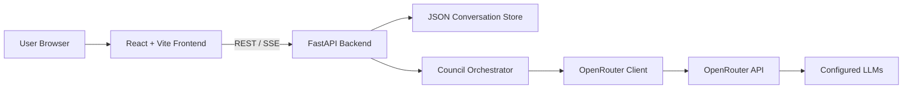
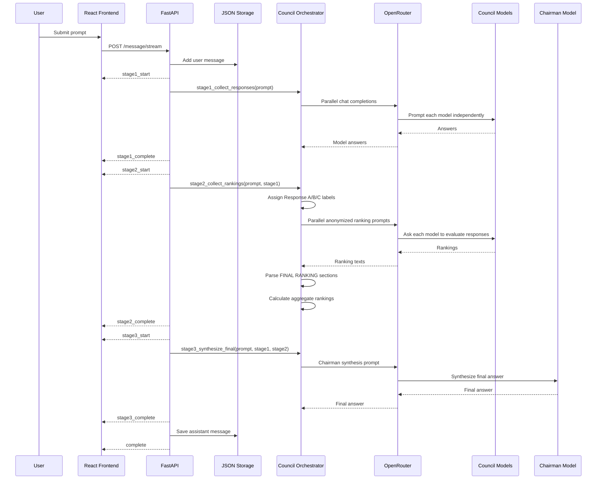

# LLM Council Low-Level Design

## 1. Research summary

Andrej Karpathy’s LLM Council is a local multi-model chat application. Instead of sending a user prompt to one model, it sends the prompt to a configured group of LLMs, collects their independent answers, asks the models to review anonymized answers from the group, and then asks a designated “Chairman” model to synthesize the final answer.

The public README describes the workflow as:

1. Stage 1: send the user query to all council models individually.
2. Stage 2: anonymize those responses as `Response A`, `Response B`, etc., and ask the models to rank them by accuracy and insight.
3. Stage 3: send all responses and reviews to a chairman model, which produces the final response.

The current repository implements this as a simple FastAPI backend, React/Vite frontend, OpenRouter LLM client, and JSON-on-disk conversation store.

Primary references:

- GitHub repository: https://github.com/karpathy/llm-council
- Karpathy launch post found during research: https://x.com/karpathy/status/1992381094667411768
- Earlier council idea post found during research: https://x.com/karpathy/status/1886220274821128668

## 2. Goals

- Provide a local ChatGPT-like interface for querying multiple LLMs together.
- Improve answer robustness by comparing multiple model outputs.
- Reduce review bias by anonymizing first-pass answers before peer ranking.
- Surface intermediate artifacts to the user:
  - individual model answers;
  - peer evaluations;
  - aggregate rankings;
  - final synthesized answer.
- Keep implementation small enough to modify easily.

## 3. Non-goals

- Production-grade authentication or authorization.
- Multi-user isolation.
- Enterprise persistence or backups.
- Guaranteed correctness of rankings.
- Formal debate between models across multiple rounds.
- Provider abstraction beyond OpenRouter.
- Strong privacy guarantees for prompts sent to third-party models.

## 4. System context



## 5. Runtime components

| Component | File(s) | Responsibility |
|---|---|---|
| React app shell | `frontend/src/App.jsx` | Holds conversation state, selected conversation, loading state, and streaming event handling. |
| API client | `frontend/src/api.js` | Calls FastAPI endpoints and parses server-sent event chunks. |
| Chat UI | `frontend/src/components/ChatInterface.jsx` | Renders user messages, stage loading states, and stage components. |
| Stage 1 UI | `frontend/src/components/Stage1.jsx` | Displays individual model responses in tabs. |
| Stage 2 UI | `frontend/src/components/Stage2.jsx` | Displays model evaluations, de-anonymized labels, parsed rankings, and aggregate ranking. |
| Stage 3 UI | `frontend/src/components/Stage3.jsx` | Displays chairman model final answer. |
| Sidebar | `frontend/src/components/Sidebar.jsx` | Lists conversations and starts new ones. |
| API server | `backend/main.py` | Exposes conversation APIs and streaming council endpoint. |
| Council orchestrator | `backend/council.py` | Implements Stage 1, Stage 2, Stage 3, ranking parsing, aggregation, and title generation. |
| OpenRouter client | `backend/openrouter.py` | Sends async chat-completion requests to OpenRouter. |
| Storage | `backend/storage.py` | Persists conversations as JSON files under `data/conversations/`. |
| Config | `backend/config.py` | Defines model list, chairman model, API URL, API key, and data directory. |

## 6. Configuration

Configuration lives in `backend/config.py`.

```python
COUNCIL_MODELS = [
    "openai/gpt-5.1",
    "google/gemini-3-pro-preview",
    "anthropic/claude-sonnet-4.5",
    "x-ai/grok-4",
]

CHAIRMAN_MODEL = "google/gemini-3-pro-preview"
OPENROUTER_API_URL = "https://openrouter.ai/api/v1/chat/completions"
DATA_DIR = "data/conversations"
```

`OPENROUTER_API_KEY` is loaded from `.env`.

## 7. Data model

### 7.1 Conversation metadata

Returned by `GET /api/conversations`.

```json
{
  "id": "uuid",
  "created_at": "2026-07-19T10:00:00.000000",
  "title": "Short Title",
  "message_count": 2
}
```

### 7.2 Conversation

Stored as `data/conversations/{conversation_id}.json`.

```json
{
  "id": "uuid",
  "created_at": "2026-07-19T10:00:00.000000",
  "title": "Short Title",
  "messages": [
    {
      "role": "user",
      "content": "User prompt"
    },
    {
      "role": "assistant",
      "stage1": [],
      "stage2": [],
      "stage3": {}
    }
  ]
}
```

### 7.3 Stage 1 result

```json
{
  "model": "openai/gpt-5.1",
  "response": "Model response text"
}
```

### 7.4 Stage 2 result

```json
{
  "model": "anthropic/claude-sonnet-4.5",
  "ranking": "Full model evaluation text with FINAL RANKING section",
  "parsed_ranking": ["Response C", "Response A", "Response B"]
}
```

### 7.5 Stage 2 metadata

```json
{
  "label_to_model": {
    "Response A": "openai/gpt-5.1",
    "Response B": "google/gemini-3-pro-preview"
  },
  "aggregate_rankings": [
    {
      "model": "google/gemini-3-pro-preview",
      "average_rank": 1.25,
      "rankings_count": 4
    }
  ]
}
```

### 7.6 Stage 3 result

```json
{
  "model": "google/gemini-3-pro-preview",
  "response": "Final synthesized answer"
}
```

## 8. API design

### 8.1 Health check

`GET /`

Response:

```json
{
  "status": "ok",
  "service": "LLM Council API"
}
```

### 8.2 List conversations

`GET /api/conversations`

Returns metadata for all conversations, sorted newest first.

### 8.3 Create conversation

`POST /api/conversations`

Request body:

```json
{}
```

Creates a UUID-backed JSON conversation file and returns the full conversation object.

### 8.4 Get conversation

`GET /api/conversations/{conversation_id}`

Returns full conversation JSON or `404` if not found.

### 8.5 Send message, non-streaming

`POST /api/conversations/{conversation_id}/message`

Request:

```json
{
  "content": "Question"
}
```

Behavior:

1. Validate conversation exists.
2. Add user message to storage.
3. Generate title if this is the first message.
4. Run all council stages.
5. Save assistant message.
6. Return all stages and metadata.

### 8.6 Send message, streaming

`POST /api/conversations/{conversation_id}/message/stream`

Uses `text/event-stream` with `data: {json}\n\n` events.

Current event types:

| Event | Payload |
|---|---|
| `stage1_start` | No data. |
| `stage1_complete` | `data: Stage1Result[]` |
| `stage2_start` | No data. |
| `stage2_complete` | `data: Stage2Result[]`, `metadata` |
| `stage3_start` | No data. |
| `stage3_complete` | `data: Stage3Result` |
| `title_complete` | `data: { "title": "..." }` |
| `complete` | No data. |
| `error` | `message: string` |

## 9. Core council flow



## 10. Detailed backend design

### 10.1 `query_model`

Location: `backend/openrouter.py`

Input:

- `model`: OpenRouter model identifier.
- `messages`: OpenAI-compatible chat message array.
- `timeout`: request timeout, default `120s`.

Behavior:

1. Build bearer auth headers from `OPENROUTER_API_KEY`.
2. POST payload to `OPENROUTER_API_URL`.
3. Extract `choices[0].message`.
4. Return:

```python
{
    "content": message.get("content"),
    "reasoning_details": message.get("reasoning_details")
}
```

5. On any exception, print an error and return `None`.

Failure semantics:

- Individual model failure is non-fatal for Stage 1 and Stage 2.
- Failed model responses are omitted from stage results.

### 10.2 `query_models_parallel`

Location: `backend/openrouter.py`

Uses `asyncio.gather` to send the same message list to every configured model concurrently.

Output:

```python
{
    "model-id": response_or_none
}
```

### 10.3 Stage 1: collect first opinions

Location: `backend/council.py`

Function: `stage1_collect_responses(user_query)`

Prompt:

```python
[{"role": "user", "content": user_query}]
```

Implementation details:

- Sends the raw user query to every model in `COUNCIL_MODELS`.
- Uses parallel execution.
- Keeps only successful responses.
- Returns `[{ "model": model, "response": content }]`.

### 10.4 Stage 2: collect peer rankings

Location: `backend/council.py`

Function: `stage2_collect_rankings(user_query, stage1_results)`

Implementation details:

1. Assign labels in insertion order:
   - first response: `Response A`
   - second response: `Response B`
   - etc.
2. Build `label_to_model`.
3. Build one ranking prompt containing:
   - original question;
   - all anonymized answers;
   - strict instructions to end with a `FINAL RANKING:` section.
4. Send that same anonymized prompt to all council models in parallel.
5. Parse each ranking text using `parse_ranking_from_text`.
6. Return:
   - stage 2 model ranking results;
   - `label_to_model`.

Important design property:

- Model identities are hidden inside the ranking prompt, reducing explicit brand/model favoritism.

Current limitation:

- A model may still identify its own style or leak preferences from content.
- The same model that generated a response can rank the full anonymous set, including its own response.
- Ranking parsing depends on models following the requested `FINAL RANKING:` format.

### 10.5 Ranking parser

Location: `backend/council.py`

Function: `parse_ranking_from_text(ranking_text)`

Algorithm:

1. If `FINAL RANKING:` exists, inspect text after it.
2. Prefer numbered matches like `1. Response A`.
3. Fallback to all `Response X` matches in the ranking section.
4. If no explicit final section exists, fallback to all `Response X` matches in the full response.

Output:

```python
["Response C", "Response A", "Response B"]
```

Known edge cases:

- Duplicate labels can be returned.
- Missing labels are not filled in.
- Lowercase or non-English variants are not parsed.
- Labels beyond `Response Z` are not meaningfully supported by the `chr(65 + i)` scheme.

### 10.6 Aggregate rankings

Location: `backend/council.py`

Function: `calculate_aggregate_rankings(stage2_results, label_to_model)`

Algorithm:

1. For each parsed ranking, convert response label to model name.
2. Record numeric position for each model.
3. Average each model’s observed positions.
4. Sort ascending by average rank.

Lower average rank is better.

Example:

```json
{
  "model": "google/gemini-3-pro-preview",
  "average_rank": 1.25,
  "rankings_count": 4
}
```

Current limitation:

- Missing votes reduce `rankings_count`; they are not penalized.
- Self-votes are included.
- No tie-breaking beyond sort order.

### 10.7 Stage 3: chairman synthesis

Location: `backend/council.py`

Function: `stage3_synthesize_final(user_query, stage1_results, stage2_results)`

Prompt includes:

- original question;
- Stage 1 responses with actual model identities;
- Stage 2 peer ranking texts with actual reviewer identities;
- instruction to synthesize one final answer.

Failure behavior:

If chairman model returns `None`, the function returns:

```json
{
  "model": "configured-chairman-model",
  "response": "Error: Unable to generate final synthesis."
}
```

### 10.8 Title generation

Location: `backend/council.py`

Function: `generate_conversation_title(user_query)`

Uses `google/gemini-2.5-flash` with a short-title prompt. In streaming mode, this runs concurrently while the council stages execute.

## 11. Frontend design

### 11.1 State ownership

`frontend/src/App.jsx` owns:

- `conversations`
- `currentConversationId`
- `currentConversation`
- `isLoading`

The app loads conversation metadata on mount and loads full conversation details when a conversation is selected.

### 11.2 Send-message behavior

`handleSendMessage(content)`:

1. Requires an active conversation.
2. Sets global loading state.
3. Optimistically appends the user message.
4. Optimistically appends a placeholder assistant message:

```js
{
  role: 'assistant',
  stage1: null,
  stage2: null,
  stage3: null,
  metadata: null,
  loading: {
    stage1: false,
    stage2: false,
    stage3: false
  }
}
```

5. Calls `api.sendMessageStream`.
6. Updates the last assistant message as stage events arrive.
7. Reloads conversation metadata when title or full completion arrives.

Current UI limitation:

- The input form only renders when `conversation.messages.length === 0`, so existing conversations cannot continue through the current UI without changing `ChatInterface.jsx`.

### 11.3 Streaming parser

`frontend/src/api.js` reads from `response.body.getReader()`, decodes chunks, splits on newline, and parses lines starting with `data: `.

Current limitation:

- The parser assumes each SSE JSON payload arrives fully on a single decoded chunk/line. A robust parser should buffer incomplete chunks.

### 11.4 Stage views

Stage 1:

- Tab per model.
- Shows markdown-rendered first-pass response.

Stage 2:

- Tab per reviewer model.
- De-anonymizes `Response A/B/C` labels for readability.
- Shows extracted ranking and aggregate ranking.

Stage 3:

- Shows chairman model name and markdown-rendered final answer.

## 12. Persistence design

Storage is intentionally simple:

- Directory: `data/conversations`
- File per conversation: `{uuid}.json`
- Synchronous file reads/writes
- Entire conversation file rewritten on each update

Pros:

- Easy to inspect and modify.
- No database setup required.
- Works for local single-user usage.

Cons:

- No locking.
- No transactional writes.
- No pagination.
- No schema migrations.
- Not suitable for concurrent writes or multi-user deployment.

## 13. Error handling

Current behavior:

- Missing conversation returns HTTP `404`.
- Individual OpenRouter request errors are printed and converted to `None`.
- Stage 1 omits failed model responses.
- `run_full_council` returns a user-facing error if all Stage 1 models fail.
- Streaming endpoint catches all exceptions and emits an SSE `error` event.

Gaps:

- No structured logging.
- No retry or backoff.
- No model-specific rate-limit handling.
- No cost-budget failure mode.
- No user-visible partial failure summary beyond omitted model outputs.
- No validation for missing `OPENROUTER_API_KEY` at startup.

## 14. Security and privacy considerations

Current implementation is local-dev oriented.

Risks:

- Prompts and model outputs are sent to OpenRouter and underlying providers.
- Conversation files are stored locally in plaintext.
- No authentication on backend endpoints.
- CORS permits local frontend origins.
- API key is loaded from `.env`, but runtime does not fail fast if it is absent.

Recommended controls for production:

- Add authentication.
- Encrypt or secure local data directory.
- Add retention controls.
- Add provider disclosure in UI.
- Add request-size limits.
- Validate API key at startup.
- Avoid logging sensitive prompt content.

## 15. Performance and cost

For `N` council models:

- Stage 1 makes `N` model calls in parallel.
- Stage 2 makes `N` model calls in parallel.
- Stage 3 makes `1` chairman call.
- First-message title generation makes `1` additional call.

Total calls per first message:

```text
2N + 2
```

Total calls per later message:

```text
2N + 1
```

With the default `N = 4`, this means:

- first message: `10` model calls;
- later message: `9` model calls.

Latency is approximately:

```text
max(Stage 1 model latency)
+ max(Stage 2 model latency)
+ Chairman latency
```

Title generation usually does not add latency in streaming mode because it runs in parallel and is awaited near the end.

## 16. Extensibility points

### 16.1 Change council members

Edit `COUNCIL_MODELS` in `backend/config.py`.

### 16.2 Change chairman model

Edit `CHAIRMAN_MODEL` in `backend/config.py`.

### 16.3 Add another provider

Introduce a provider interface:

```python
class LLMClient:
    async def query_model(self, model: str, messages: list[dict], timeout: float) -> dict | None:
        ...
```

Then implement:

- `OpenRouterClient`
- `OpenAIClient`
- `AnthropicClient`
- `GoogleClient`
- local/Ollama client

### 16.4 Add stronger ranking aggregation

Possible algorithms:

- Borda count.
- Median rank.
- Pairwise majority wins.
- Self-vote exclusion.
- Weighted ranking by model trust score.
- Penalize missing labels.

### 16.5 Add multi-turn context

Current council prompts use only the latest user query. To support multi-turn conversations, construct message history from prior conversation messages and include:

- prior user messages;
- prior Stage 3 final answers;
- optional compressed summaries of prior Stage 1/Stage 2 artifacts.

Avoid sending all prior intermediate artifacts by default because token cost grows quickly.

## 17. Proposed production hardening backlog

Priority 0:

- Validate `OPENROUTER_API_KEY` at startup.
- Add request-size limits.
- Add robust SSE buffering in frontend.
- Allow follow-up messages in existing conversations.
- Show partial model failures in UI.

Priority 1:

- Add retries with exponential backoff for transient provider failures.
- Add structured logs with request IDs.
- Add per-request cost and token accounting if provider metadata is available.
- Add model-call timeout configuration.
- Add persistent metadata for aggregate rankings; currently non-streaming returns metadata, but stored assistant messages do not include it.

Priority 2:

- Move storage to SQLite.
- Add migration layer.
- Add auth for non-local deployments.
- Add provider abstraction.
- Add configurable council profiles.

## 18. Key implementation tradeoffs

| Choice | Benefit | Cost |
|---|---|---|
| OpenRouter only | One API surface for many models. | Provider-specific features and metadata are limited. |
| JSON files | Zero database setup. | Poor concurrency, no indexing, no migrations. |
| Parallel model calls | Lower latency. | Higher burst cost and rate-limit exposure. |
| Anonymized reviews | Reduces explicit model-brand bias. | Does not eliminate self-recognition or content-style bias. |
| Chairman synthesis | Produces one usable answer. | Final answer can still overrule useful minority views. |
| Regex ranking parser | Simple and transparent. | Brittle when models ignore format. |

## 19. Local run path

Backend:

```bash
uv sync
uv run python -m backend.main
```

Frontend:

```bash
cd frontend
npm install
npm run dev
```

Browser:

```text
http://localhost:5173
```

Required `.env`:

```text
OPENROUTER_API_KEY=sk-or-v1-...
```

