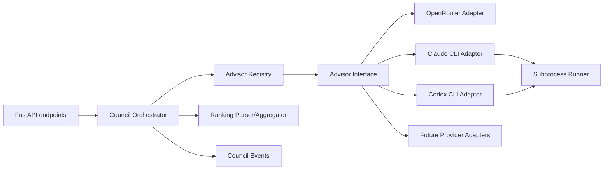

# Provider Interface and Council Orchestrator Implementation Plan

## 1. Target outcome

Refactor the current OpenRouter-only council into an extensible provider system.

The end state should support:

- API providers:
  - OpenRouter
  - OpenAI API
  - Anthropic API
  - Google Gemini API
  - xAI API
  - local HTTP providers such as Ollama or LM Studio
- subscription/CLI providers:
  - Claude Code via `claude`
  - Codex via `codex exec`
- future providers without changing the council stage logic.

The orchestrator should only know about advisors and responses. It should not know whether a response came from HTTP, a CLI subprocess, local inference, or another transport.

## 2. Existing problem

Current backend coupling:

```text
backend/council.py
  -> backend/openrouter.py
      -> OpenRouter API
```

Issues:

- Council stages are coupled to OpenRouter model strings.
- Provider failure handling is provider-specific and weakly structured.
- No clean way to mix API-backed and subscription-backed advisors.
- No interface for health checks, rate-limit errors, model availability, or subprocess execution.
- Adding Claude/Codex CLI directly into `council.py` would create hard-to-maintain branching.

## 3. Proposed architecture



## 4. New module layout

```text
backend/
  advisors/
    __init__.py
    base.py
    config.py
    registry.py
    errors.py
    health.py
    subprocess_runner.py
    adapters/
      __init__.py
      openrouter.py
      claude_cli.py
      codex_cli.py
      openai_api.py        # future
      anthropic_api.py     # future
      gemini_api.py        # future
      ollama.py            # future
  orchestration/
    __init__.py
    council_orchestrator.py
    prompts.py
    ranking.py
    events.py
```

Keep `backend/council.py` temporarily as a compatibility facade during migration, then remove or shrink it after API endpoints use the new orchestrator.

## 5. Provider interface

### 5.1 Data contracts

Use Pydantic models or dataclasses. Pydantic is preferable because the backend already uses it and config/API serialization will benefit from validation.

```python
from enum import Enum
from typing import Any, Literal
from pydantic import BaseModel, Field


class AdvisorMode(str, Enum):
    API = "api"
    CLI = "cli"
    LOCAL = "local"


class AdvisorRole(str, Enum):
    COUNCIL_MEMBER = "council_member"
    CHAIRMAN = "chairman"
    TITLE_GENERATOR = "title_generator"


class AdvisorStatus(str, Enum):
    SUCCESS = "success"
    FAILED = "failed"
    TIMEOUT = "timeout"
    SKIPPED = "skipped"


class AdvisorMessage(BaseModel):
    role: Literal["system", "user", "assistant"]
    content: str


class AdvisorRequest(BaseModel):
    run_id: str
    stage: Literal["stage1", "stage2", "stage3", "title", "health"]
    messages: list[AdvisorMessage]
    prompt_text: str | None = None
    timeout_seconds: float | None = None
    response_format: Literal["text", "json"] = "text"
    metadata: dict[str, Any] = Field(default_factory=dict)


class AdvisorResponse(BaseModel):
    advisor_id: str
    display_name: str
    provider: str
    mode: AdvisorMode
    status: AdvisorStatus
    content: str | None = None
    raw_output: str | None = None
    raw_error: str | None = None
    error_type: str | None = None
    user_message: str | None = None
    latency_ms: int | None = None
    metadata: dict[str, Any] = Field(default_factory=dict)


class AdvisorHealth(BaseModel):
    advisor_id: str
    display_name: str
    provider: str
    mode: AdvisorMode
    installed: bool | None = None
    authenticated: bool | None = None
    model_available: bool | None = None
    healthy: bool
    message: str | None = None
```

### 5.2 Abstract interface

```python
from abc import ABC, abstractmethod


class Advisor(ABC):
    id: str
    display_name: str
    provider: str
    mode: AdvisorMode
    roles: set[AdvisorRole]
    supports_streaming: bool = False

    @abstractmethod
    async def ask(self, request: AdvisorRequest) -> AdvisorResponse:
        ...

    async def health_check(self) -> AdvisorHealth:
        return AdvisorHealth(
            advisor_id=self.id,
            display_name=self.display_name,
            provider=self.provider,
            mode=self.mode,
            healthy=True,
            message="No explicit health check implemented",
        )
```

Design rule:

```text
Every provider adapter maps its native output/error shape into AdvisorResponse.
No native provider object should leak into orchestration code.
```

## 6. Provider config model

Move provider config out of Python constants into a structured config file.

Recommended file:

```text
backend/advisors.yaml
```

Initial schema:

```yaml
defaults:
  stage_timeout_seconds: 240
  max_parallel_api_requests: 8
  max_parallel_cli_processes: 2

advisors:
  - id: openrouter-gpt
    display_name: GPT via OpenRouter
    provider: openrouter
    mode: api
    enabled: false
    roles: [council_member]
    model: openai/gpt-5.1
    env_api_key: OPENROUTER_API_KEY

  - id: claude-sonnet-cli
    display_name: Claude Sonnet via Claude Code
    provider: claude_cli
    mode: cli
    enabled: true
    roles: [council_member]
    command: claude
    model: sonnet
    timeout_seconds: 180
    tools: []

  - id: codex-terra-cli
    display_name: Codex GPT-5.6 Terra
    provider: codex_cli
    mode: cli
    enabled: true
    roles: [council_member, chairman]
    command: codex
    model: gpt-5.6-terra
    timeout_seconds: 240
    sandbox: read-only
    approval_policy: never

chairman:
  advisor_id: codex-terra-cli

title_generator:
  advisor_id: codex-terra-cli
```

Add Python models:

```text
backend/advisors/config.py
```

Responsibilities:

- Load YAML.
- Validate required fields by provider type.
- Expand env var names, but do not log secret values.
- Provide defaults.

Dependency note:

- Add `pyyaml` or use `tomllib` with TOML if avoiding new dependencies.
- YAML is more readable for users, TOML is dependency-free on Python 3.11+.
- Current project says Python 3.10+, so YAML with `pyyaml` is pragmatic.

## 7. Adapter responsibilities

### 7.1 OpenRouter adapter

Location:

```text
backend/advisors/adapters/openrouter.py
```

Wrap current `backend/openrouter.py` logic.

Responsibilities:

- Build OpenRouter chat-completion request.
- Use configured model.
- Handle API key missing.
- Map HTTP errors and rate limits to structured `AdvisorResponse`.

This is the lowest-risk first adapter because it preserves existing behavior.

### 7.2 Claude CLI adapter

Location:

```text
backend/advisors/adapters/claude_cli.py
```

Responsibilities:

- Build `claude -p` command.
- Use `--model` if configured.
- Prefer `--output-format text` initially; add JSON later.
- Disable tools for advisory mode where supported.
- Execute via shared subprocess runner.
- Parse stdout into content.
- Classify stderr/non-zero exit into:
  - `not_installed`
  - `not_authenticated`
  - `usage_limit_exceeded`
  - `model_unavailable`
  - `timeout`
  - `unknown_cli_error`

### 7.3 Codex CLI adapter

Location:

```text
backend/advisors/adapters/codex_cli.py
```

Responsibilities:

- Build `codex exec` command.
- Pass model, sandbox, approval policy, and workspace directory.
- Use read-only sandbox by default.
- Execute via shared subprocess runner.
- Parse stdout into content.
- Classify stderr/non-zero exit.

Important:

- Do not use dangerous bypass flags.
- Do not allow adapter config to set `danger-full-access` unless there is a separate explicit unsafe config gate.

## 8. Subprocess handoff implementation

New file:

```text
backend/advisors/subprocess_runner.py
```

Interface:

```python
class SubprocessResult(BaseModel):
    exit_code: int | None
    stdout: str
    stderr: str
    timed_out: bool
    latency_ms: int


async def run_subprocess(
    args: list[str],
    input_text: str,
    timeout_seconds: float,
    cwd: str | None = None,
    env: dict[str, str] | None = None,
) -> SubprocessResult:
    ...
```

Rules:

- Use `asyncio.create_subprocess_exec`.
- Never use `shell=True`.
- Prefer stdin for prompt transfer.
- Kill process on timeout.
- Limit captured output size to avoid memory blowups.
- Preserve stderr for logs/debug, but expose sanitized errors to UI.

## 9. Orchestrator design

New file:

```text
backend/orchestration/council_orchestrator.py
```

Primary class:

```python
class CouncilOrchestrator:
    def __init__(
        self,
        registry: AdvisorRegistry,
        ranking_parser: RankingParser,
        event_sink: CouncilEventSink | None = None,
    ):
        ...

    async def run_full_council(self, user_query: str) -> CouncilRunResult:
        ...

    async def run_streaming_council(self, user_query: str):
        ...
```

### 9.1 Result contracts

```python
class Stage1Answer(BaseModel):
    advisor_id: str
    display_name: str
    provider: str
    mode: AdvisorMode
    response: str
    status: AdvisorStatus
    error_type: str | None = None
    latency_ms: int | None = None


class Stage2Ranking(BaseModel):
    advisor_id: str
    display_name: str
    provider: str
    mode: AdvisorMode
    ranking: str | None
    parsed_ranking: list[str]
    status: AdvisorStatus
    error_type: str | None = None
    latency_ms: int | None = None


class Stage3Synthesis(BaseModel):
    advisor_id: str
    display_name: str
    provider: str
    mode: AdvisorMode
    response: str
    status: AdvisorStatus
    error_type: str | None = None


class CouncilRunResult(BaseModel):
    stage1: list[Stage1Answer]
    stage2: list[Stage2Ranking]
    stage3: Stage3Synthesis
    metadata: dict[str, Any]
```

### 9.2 Stage 1 algorithm

```text
1. Resolve enabled advisors with council_member role.
2. Build Stage 1 prompt.
3. Run advisors through bounded parallel executor.
4. Keep successes for Stage 2.
5. Preserve failures in metadata/UI diagnostics.
6. If no advisor succeeds, return terminal council error.
```

### 9.3 Stage 2 algorithm

```text
1. Assign anonymous labels only to successful Stage 1 answers.
2. Build label_to_advisor mapping.
3. Build anonymized peer-review prompt.
4. Ask enabled council advisors to rank the anonymous responses.
5. Parse structured JSON ranking if present.
6. Fallback to current FINAL RANKING parser.
7. Aggregate rankings.
```

### 9.4 Stage 3 algorithm

```text
1. Resolve configured chairman advisor.
2. If chairman is disabled/unhealthy, use configured fallback policy.
3. Build synthesis prompt using Stage 1, Stage 2, and aggregate ranking.
4. Ask chairman advisor.
5. If chairman fails:
   a. fallback to first successful advisor if configured; or
   b. return transparent failure.
```

### 9.5 Handoff policy

The orchestrator owns handoff between stages.

```text
Stage 1 output -> anonymizer -> Stage 2 input
Stage 2 output -> parser/aggregator -> Stage 3 input
Stage 3 output -> API/storage/UI
```

Adapters never call each other.

Adapters never call the orchestrator.

The registry creates advisors, but does not run stages.

## 10. Bounded parallel executor

New helper:

```text
backend/orchestration/executor.py
```

Purpose:

- Run API advisors and CLI advisors with different concurrency limits.
- Avoid spawning too many CLI processes.
- Return results in advisor config order for stable UI labels.

Algorithm:

```python
async def run_advisors_parallel(advisors, request_factory):
    api_sem = asyncio.Semaphore(max_parallel_api_requests)
    cli_sem = asyncio.Semaphore(max_parallel_cli_processes)

    async def run_one(advisor):
        sem = cli_sem if advisor.mode == AdvisorMode.CLI else api_sem
        async with sem:
            return await advisor.ask(request_factory(advisor))

    return await asyncio.gather(*(run_one(a) for a in advisors))
```

## 11. API migration plan

### 11.1 Keep response compatibility first

The frontend currently expects:

```json
{
  "model": "...",
  "response": "..."
}
```

During Phase 1, return both old and new fields:

```json
{
  "model": "codex-terra-cli",
  "advisor_id": "codex-terra-cli",
  "display_name": "Codex GPT-5.6 Terra",
  "provider": "codex_cli",
  "mode": "cli",
  "response": "..."
}
```

This avoids breaking the UI while enabling richer rendering.

### 11.2 New endpoints

Add:

```http
GET /api/advisors
GET /api/advisors/health
POST /api/advisors/{advisor_id}/test
```

These are not required for the first backend refactor, but they are needed for a usable subscription-backed setup.

## 12. Implementation phases

### Phase 0: Baseline verification

Deliverables:

- Confirm backend tests or manual smoke path.
- Capture existing API response shapes.
- Add a small fixture for ranking parser behavior.

No functional change.

### Phase 1: Interface and OpenRouter adapter

Deliverables:

- `backend/advisors/base.py`
- `backend/advisors/config.py`
- `backend/advisors/registry.py`
- `backend/advisors/adapters/openrouter.py`
- `backend/orchestration/council_orchestrator.py`
- Existing OpenRouter behavior routed through the new interface.

Acceptance criteria:

- App still works with only `OPENROUTER_API_KEY`.
- Stage 1/2/3 output remains frontend-compatible.
- No Claude/Codex integration yet.

### Phase 2: Subprocess runner

Deliverables:

- `backend/advisors/subprocess_runner.py`
- Unit/manual tests for:
  - success;
  - non-zero exit;
  - timeout;
  - large stderr/stdout truncation.

Acceptance criteria:

- Runner can execute a harmless command without shell injection risk.
- Timeout reliably kills the child process.

### Phase 3: Claude CLI adapter

Deliverables:

- `backend/advisors/adapters/claude_cli.py`
- Config entries for Claude subscription advisor.
- Health check.

Acceptance criteria:

- `claude -p` can answer a Stage 1 prompt.
- Failure when unauthenticated is surfaced as advisor failure, not server crash.
- Tools are disabled or restricted.

### Phase 4: Codex CLI adapter

Deliverables:

- `backend/advisors/adapters/codex_cli.py`
- Config entry for GPT-5.6 Terra via Codex CLI.
- Health check.

Acceptance criteria:

- `codex exec --model gpt-5.6-terra` can answer a Stage 1 prompt if available.
- If the model slug is unavailable, the adapter fails clearly.
- Codex runs read-only for advisor calls.

### Phase 5: UI visibility

Deliverables:

- Display advisor `display_name`, `provider`, `mode`.
- Show skipped/failed advisors.
- Add advisor health/settings view.

Acceptance criteria:

- User can see whether Claude/Codex/OpenRouter are enabled and healthy.
- User can distinguish API spend from subscription-backed calls.

### Phase 6: Hardening

Deliverables:

- Structured JSON ranking prompt/parser.
- Fallback chairman policy.
- Better SSE buffering in frontend.
- Persist advisor metadata in conversation JSON.

Acceptance criteria:

- Ranking parser handles JSON and legacy text.
- Stored conversations remain explainable after config changes.

## 13. Recommended first implementation slice

Do not start with Claude/Codex subprocesses.

Start with the interface and OpenRouter adapter:

```text
current working behavior
    -> same behavior through Advisor interface
    -> same UI output
```

Reason:

- It proves the abstraction without introducing CLI auth, usage limits, or subprocess complexity.
- It keeps rollback simple.
- It creates the exact seam needed for Claude/Codex.

## 14. Key decisions to confirm before implementation

1. Config format:
   - recommended: YAML with `pyyaml`;
   - alternative: TOML to avoid a new dependency if Python version supports it.

2. Chairman default:
   - recommended: `codex-terra-cli` when available;
   - fallback: first successful highest-ranked advisor.

3. CLI safety:
   - recommended: read-only/no-tools by default;
   - no dangerous bypass flags.

4. Provider failure visibility:
   - recommended: show failed/skipped advisors in UI;
   - do not silently hide failures.

5. Model fallback:
   - recommended: no silent fallback from GPT-5.6 Terra;
   - require explicit `fallback_models` config.
