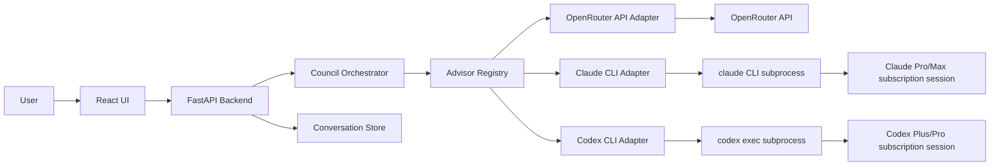
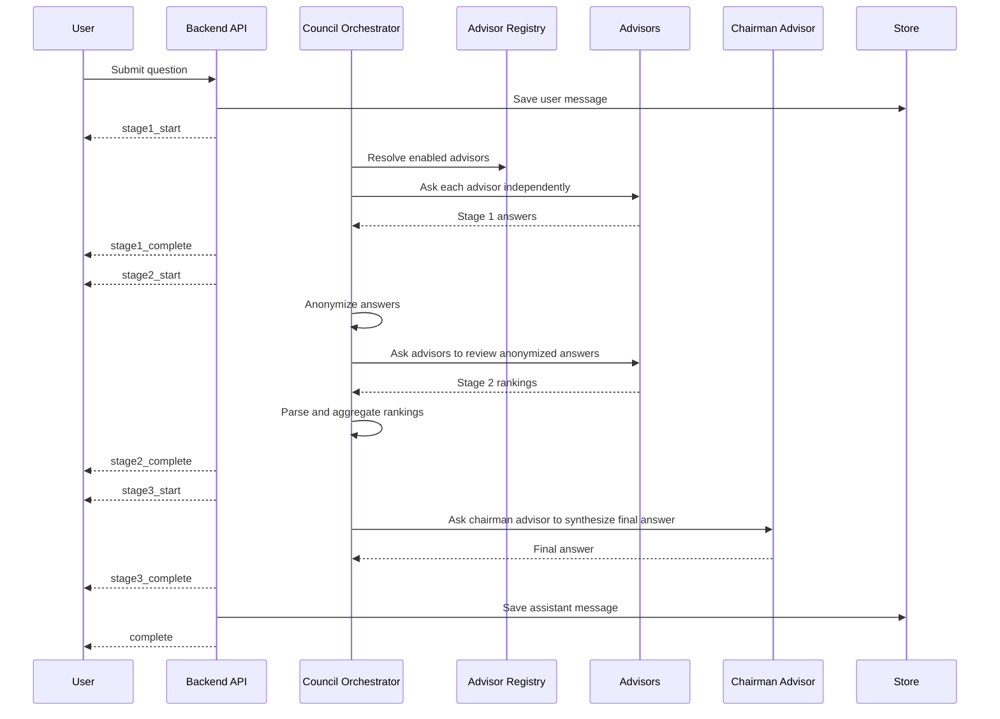

# Subscription-Backed LLM Council HLD

## 1. Objective

Design an LLM Council variant that can use paid Claude and Codex subscriptions through local CLI subprocesses instead of requiring only API-key-backed providers such as OpenRouter.

The goal is not to bypass subscription limits or scrape web UIs. The goal is to support legitimate local tool surfaces the user is already authenticated into:

- Claude Code via `claude` CLI authenticated with Claude Pro/Max.
- Codex CLI via `codex` authenticated with ChatGPT/Codex Plus/Pro.
- Existing API-backed providers such as OpenRouter as a fallback or optional council member source.

For Codex advisors, prefer GPT-5.6 Terra where the local Codex surface supports the requested model selection.

## 2. Background

The current Karpathy-style implementation uses OpenRouter:

```text
LLM Council backend -> OpenRouter API key -> provider models
```

That means it consumes API credits. Claude Pro/Max and Codex Plus/Pro subscriptions are product subscriptions, not general-purpose API keys. To use them, the system must invoke the supported local subscription-backed tools as subprocesses.

Official/current facts used for this HLD:

- Anthropic documents Claude Code access through Claude Pro/Max subscription sign-in.
- Anthropic documents that Pro/Max Claude Code subscribers have usage included in the subscription, while API users are charged by API token consumption.
- The local `claude` CLI supports non-interactive output with `claude -p/--print`.
- The local `codex` CLI supports non-interactive execution with `codex exec`.
- Current Codex documentation in this environment says Plus includes Codex on web/CLI/IDE/iOS and the GPT-5.6 model family, including Sol, Terra, and Luna. Pro provides higher Codex usage limits.

## 3. High-level architecture



## 4. Core design decision

Replace the current OpenRouter-only model client with an advisor abstraction.

Current shape:

```python
query_model(model: str, messages: list[dict]) -> dict | None
query_models_parallel(models: list[str], messages: list[dict]) -> dict
```

Target shape:

```python
class Advisor:
    id: str
    display_name: str
    provider: str
    mode: Literal["api", "cli"]
    supports_streaming: bool

    async def ask(self, request: AdvisorRequest) -> AdvisorResponse:
        ...
```

This lets the council call OpenRouter, Claude CLI, Codex CLI, or any future provider through the same orchestration path.

## 5. Advisor types

### 5.1 OpenRouter API advisor

Use case:

- Existing API-key workflow.
- Reliable programmatic model calls.
- Structured provider errors.
- Easy parallel fan-out.

Config example:

```yaml
id: openrouter-gemini-pro
provider: openrouter
mode: api
model: google/gemini-3-pro-preview
enabled: true
```

### 5.2 Claude subscription advisor

Use case:

- Use Claude Code authenticated against Claude Pro/Max.
- Avoid direct Anthropic API usage when the user wants subscription-backed usage.

Execution model:

```text
backend -> subprocess -> claude -p --output-format json/text <prompt>
```

Representative command:

```bash
claude -p \
  --model sonnet \
  --output-format json \
  --permission-mode dontAsk \
  --tools "" \
  --no-session-persistence \
  "<prompt>"
```

Important constraints:

- The user must run `claude auth` or `/login` flow beforehand.
- Subscription usage limits still apply.
- The backend must not attempt to bypass Claude Code permissions or rate limits.
- For pure question-answering, disable tools or use a restrictive permission mode. The council should not let reviewer agents mutate the repo.

Config example:

```yaml
id: claude-sonnet-subscription
provider: claude_cli
mode: cli
command: claude
model: sonnet
output_format: json
timeout_seconds: 180
tools: []
enabled: true
```

### 5.3 Codex subscription advisor

Use case:

- Use Codex authenticated against the user’s Codex/ChatGPT paid plan.
- Prefer GPT-5.6 Terra for advisor work when supported by the installed Codex CLI and account.

Execution model:

```text
backend -> subprocess -> codex exec --model gpt-5.6-terra <prompt>
```

Representative command:

```bash
codex exec \
  --model gpt-5.6-terra \
  --sandbox read-only \
  --ask-for-approval never \
  --cd <workspace> \
  "<prompt>"
```

If the exact model slug is not accepted by the local CLI, the adapter should fail clearly and suggest the installed CLI’s supported model name or configured alias. Do not silently downgrade to another model unless the config explicitly allows fallback.

Config example:

```yaml
id: codex-terra-subscription
provider: codex_cli
mode: cli
command: codex
subcommand: exec
model: gpt-5.6-terra
timeout_seconds: 240
sandbox: read-only
approval_policy: never
enabled: true
fallback_models: []
```

## 6. Updated council flow

The three-stage council pattern remains the same.



## 7. Proposed component changes

### 7.1 Advisor registry

New module:

```text
backend/advisors/registry.py
```

Responsibilities:

- Load advisor config.
- Validate enabled advisors.
- Instantiate the correct adapter class.
- Expose:

```python
get_council_advisors() -> list[Advisor]
get_chairman_advisor() -> Advisor
```

### 7.2 Advisor adapters

New modules:

```text
backend/advisors/base.py
backend/advisors/adapters/__init__.py
backend/advisors/adapters/openrouter.py
backend/advisors/adapters/claude_cli.py
backend/advisors/adapters/codex_cli.py
```

Common response shape:

```python
{
  "advisor_id": "codex-terra-subscription",
  "display_name": "Codex GPT-5.6 Terra",
  "provider": "codex_cli",
  "content": "...",
  "raw": "...",
  "error": null,
  "latency_ms": 12345
}
```

### 7.3 Subprocess runner

New module:

```text
backend/advisors/subprocess_runner.py
```

Responsibilities:

- Execute CLI commands asynchronously.
- Pass prompt through `stdin` where possible to avoid shell escaping issues.
- Enforce timeout.
- Capture stdout/stderr separately.
- Return structured exit code, stdout, stderr, and latency.
- Kill child process on timeout.

Do not invoke subprocesses through `shell=True`.

Target implementation style:

```python
process = await asyncio.create_subprocess_exec(
    *args,
    stdin=asyncio.subprocess.PIPE,
    stdout=asyncio.subprocess.PIPE,
    stderr=asyncio.subprocess.PIPE,
)
stdout, stderr = await asyncio.wait_for(
    process.communicate(prompt.encode("utf-8")),
    timeout=timeout_seconds,
)
```

### 7.4 Council orchestrator

Modify:

```text
backend/council.py
```

Replace:

```python
query_models_parallel(COUNCIL_MODELS, messages)
query_model(CHAIRMAN_MODEL, messages)
```

With:

```python
query_advisors_parallel(advisors, council_request)
query_advisor(chairman_advisor, synthesis_request)
```

The orchestrator should not care whether an advisor is API-backed or CLI-backed.

### 7.5 Config

Add a config file:

```text
backend/advisors.yaml
```

Example:

```yaml
council:
  timeout_seconds: 240
  max_parallel_cli_processes: 2
  max_parallel_api_requests: 8

advisors:
  - id: claude-sonnet-subscription
    display_name: Claude Sonnet via Claude Pro
    provider: claude_cli
    enabled: true
    role: council_member
    command: claude
    model: sonnet
    output_format: text
    timeout_seconds: 180
    tools: []

  - id: codex-terra-subscription
    display_name: Codex GPT-5.6 Terra
    provider: codex_cli
    enabled: true
    role: council_member
    command: codex
    model: gpt-5.6-terra
    sandbox: read-only
    approval_policy: never
    timeout_seconds: 240

  - id: openrouter-gemini
    display_name: Gemini via OpenRouter
    provider: openrouter
    enabled: false
    role: council_member
    model: google/gemini-3-pro-preview

chairman:
  advisor_id: codex-terra-subscription
```

## 8. Prompt contracts

CLI agents are more agentic than raw completion APIs. The prompts must constrain behavior.

### 8.1 Common advisor system instructions

Use for Stage 1:

```text
You are one advisor in an LLM Council.
Answer the user's question directly.
Do not modify files.
Do not run commands.
Do not ask follow-up questions unless the question is impossible to answer safely.
Return only the answer content.
```

For Codex specifically:

```text
You are acting as an analytical advisor, not as a coding agent.
Do not edit the repository.
Do not create files.
Do not run tests.
Do not call external tools unless explicitly instructed in this prompt.
```

For Claude Code specifically:

```text
You are acting as an analytical advisor through Claude Code.
Do not edit files.
Do not use tools.
Return a concise answer to the prompt.
```

### 8.2 Stage 2 review prompt

Keep Karpathy’s anonymization, but add strict JSON mode if the adapter supports it.

Preferred output:

```json
{
  "evaluations": [
    {
      "label": "Response A",
      "strengths": "...",
      "weaknesses": "..."
    }
  ],
  "final_ranking": ["Response C", "Response A", "Response B"]
}
```

Fallback output:

```text
FINAL RANKING:
1. Response C
2. Response A
3. Response B
```

### 8.3 Chairman prompt

The chairman should receive:

- original question;
- Stage 1 answers;
- Stage 2 evaluations;
- aggregate ranking;
- explicit instruction to preserve useful minority views.

Example instruction:

```text
Synthesize a final answer.
Use the rankings as evidence, not as an absolute vote.
If a lower-ranked response contains an important unique point, include it.
Call out uncertainty where the council disagrees.
```

## 9. Subprocess safety model

Because Claude Code and Codex are agentic tools, the council must run them in read-only/question-answering mode by default.

Required controls:

- Run Codex with `--sandbox read-only`.
- Run Codex with `--ask-for-approval never` only when sandbox is read-only.
- Run Claude with no tools where supported, for example `--tools ""`.
- Prefer non-persistent sessions for council calls.
- Pass prompts via stdin, not shell-escaped command strings.
- Set per-advisor timeout.
- Set global CLI process concurrency.
- Capture stderr but do not expose raw stderr to end users by default.
- Never use `--dangerously-bypass-*` flags for council calls.

## 10. Concurrency model

API model calls are cheap to parallelize. CLI agents are heavier because they boot local runtimes, read config, may touch workspace context, and consume subscription usage.

Recommended policy:

```text
API advisors: run all enabled API advisors in parallel.
CLI advisors: run with bounded concurrency, default 2.
Overall stage: complete when all advisors finish, timeout, or fail.
```

Use an async semaphore:

```python
cli_semaphore = asyncio.Semaphore(max_parallel_cli_processes)
```

This avoids launching many `claude`/`codex` processes at once.

## 11. Usage-limit behavior

Subscription-backed providers have usage limits that are not equivalent to API billing.

The adapter should detect common failures:

- not logged in;
- plan does not include the CLI surface;
- usage limit exceeded;
- model not available;
- command not installed;
- timeout;
- non-zero exit code.

Return structured errors:

```json
{
  "advisor_id": "claude-sonnet-subscription",
  "status": "failed",
  "error_type": "usage_limit_exceeded",
  "user_message": "Claude CLI reported a usage limit. This advisor was skipped."
}
```

The council should continue with remaining advisors if at least one Stage 1 answer succeeds.

## 12. Authentication lifecycle

Authentication is external to the app.

The web app should not collect Claude or Codex credentials.

Setup checks:

```bash
claude auth
claude -p "Say OK"

codex login
codex exec "Say OK"
```

Backend health endpoint extension:

```http
GET /api/advisors/health
```

Response:

```json
[
  {
    "advisor_id": "codex-terra-subscription",
    "installed": true,
    "authenticated": true,
    "model_available": true,
    "last_checked_at": "2026-07-19T12:00:00Z"
  }
]
```

Implementation note:

- Health checks should use tiny prompts.
- Cache health results for a short TTL to avoid wasting subscription quota.

## 13. UI changes

Add an advisor settings page.

Features:

- List advisors and status:
  - enabled/disabled;
  - provider;
  - mode: API or CLI;
  - health status;
  - last error.
- Select chairman advisor.
- Set per-advisor timeout.
- Set max parallel CLI advisors.
- Run test prompt.

Stage displays should show provider mode:

```text
Codex GPT-5.6 Terra · codex_cli · subscription
Claude Sonnet · claude_cli · subscription
Gemini Pro · openrouter · api
```

If an advisor fails, show:

```text
Skipped: usage limit exceeded
```

Do not hide failed advisors silently.

## 14. Storage changes

Persist richer advisor metadata.

Stage result should include:

```json
{
  "advisor_id": "codex-terra-subscription",
  "display_name": "Codex GPT-5.6 Terra",
  "provider": "codex_cli",
  "mode": "cli",
  "response": "...",
  "status": "success",
  "latency_ms": 42000,
  "error": null
}
```

This allows old conversations to remain explainable even if advisor config changes later.

## 15. Deployment constraints

This architecture is local-machine-first.

It should not be deployed as a shared hosted service unless every user runs their own local worker. Subscription-backed CLI sessions are tied to the authenticated local user.

Supported deployment:

```text
User laptop
  - frontend
  - backend
  - claude CLI authenticated as user
  - codex CLI authenticated as user
```

Unsupported/default-deny deployment:

```text
Shared server with one user's Claude/Codex login serving many users
```

That would create account-sharing, privacy, and policy risks.

## 16. Failure handling

| Failure | Behavior |
|---|---|
| CLI command missing | Mark advisor unhealthy; show setup instruction. |
| Not authenticated | Mark advisor unhealthy; ask user to run `claude auth` or `codex login`. |
| Model unavailable | Mark advisor failed; suggest config correction. |
| Usage limit exceeded | Skip advisor for this run; continue with others. |
| Timeout | Kill process; mark advisor timeout. |
| Non-zero exit | Capture stderr; classify if possible. |
| Chairman fails | Fallback to highest aggregate-ranked successful advisor, or return transparent error if disabled. |

## 17. Rollout plan

### Phase 1: Adapter foundation

- Add advisor base types.
- Move OpenRouter into an adapter.
- Keep current behavior unchanged.
- Add advisor config.

### Phase 2: CLI subprocess support

- Add subprocess runner.
- Add Claude CLI adapter.
- Add Codex CLI adapter.
- Add advisor health endpoint.
- Add bounded CLI concurrency.

### Phase 3: UI and observability

- Add advisor settings/status page.
- Show provider/mode/error metadata in stage views.
- Persist richer advisor metadata.

### Phase 4: Hardening

- Add structured output parsing for Stage 2.
- Add retry policy for safe transient errors.
- Add run-level audit logs.
- Add optional local queue for long council runs.

## 18. Key risks

### 18.1 CLI instability

CLI output formats and model aliases may change. Keep adapters thin and version-tolerant.

### 18.2 Usage-limit opacity

Subscriptions do not expose the same precise billing metadata as APIs. The app should report advisor availability, not attempt exact token accounting unless the CLI exposes it.

### 18.3 Agentic side effects

Codex and Claude Code can be tool-using agents. The council must constrain them to read-only/no-tool behavior for advisory calls.

### 18.4 Latency

CLI subprocesses are slower than direct API calls. Bounded concurrency improves stability but increases total response time.

### 18.5 Terms and account policy

The app must use official CLI authentication flows and must not share one subscription account across multiple users.

## 19. Recommended default council profile

For a local personal setup:

```yaml
advisors:
  - codex-terra-subscription
  - claude-sonnet-subscription
  - openrouter-gemini # optional, disabled by default if avoiding API spend

chairman:
  advisor_id: codex-terra-subscription

limits:
  max_parallel_cli_processes: 2
  per_advisor_timeout_seconds: 240
```

Rationale:

- Codex GPT-5.6 Terra acts as the primary synthesis advisor.
- Claude provides an independent second perspective.
- OpenRouter remains optional for broader model diversity.
- CLI concurrency of 2 avoids excessive local process pressure and reduces the chance of burning through subscription limits quickly.
